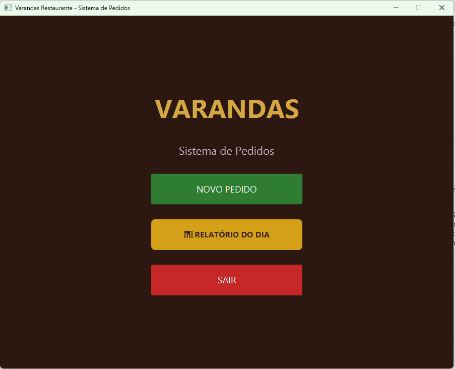
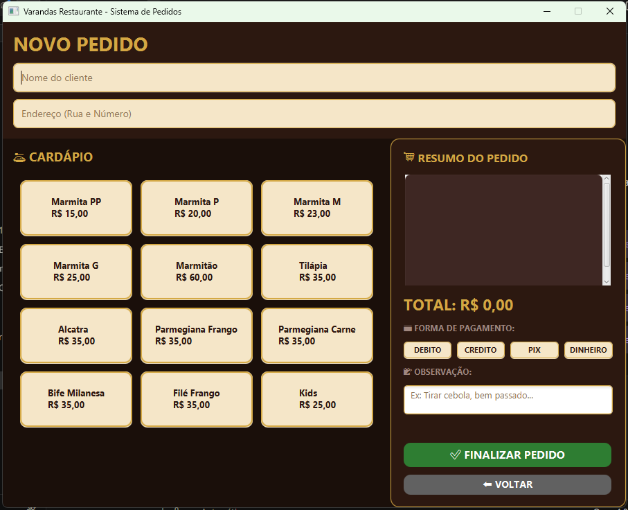
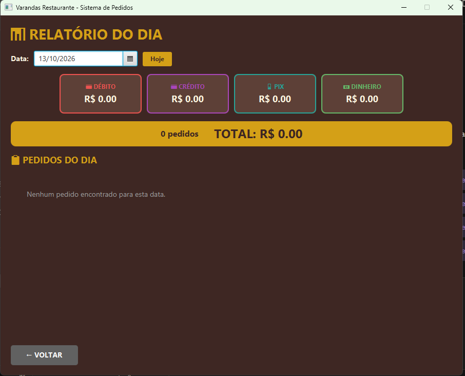

# 🍽️ Sistema Varandas — Pedidos de Restaurante

[](https://github.com/guilhermecesars/sistema-varandas/actions/workflows/build.yml)


Aplicação **desktop** para um restaurante de marmitas registrar pedidos no dia a dia:
cadastro de clientes, montagem do pedido (marmitas, pratos e tamanhos), forma de
pagamento e um **relatório do dia** com o total faturado. Nasceu de uma necessidade
real de um cliente e virou meu principal projeto de estudo em Java.

## 📸 Telas

| Início | Novo pedido | Relatório do dia |
| :----: | :---------: | :--------------: |
|  |  |  |

## ✨ Funcionalidades

- 🧾 **Novo pedido** com cliente, itens (marmitas/pratos), tamanho e forma de pagamento
- 💾 **Persistência em SQLite** — os pedidos ficam salvos entre execuções
- 📊 **Relatório do dia** com total de vendas
- 🖥️ Interface gráfica em **JavaFX** (e uma versão em modo texto/console)

## 🛠️ Tecnologias

| Área           | Tecnologia                                   |
| -------------- | -------------------------------------------- |
| Linguagem      | Java 17                                      |
| Interface      | JavaFX 17                                     |
| Banco de dados | SQLite (via `sqlite-jdbc`)                    |
| Build          | Maven (fat JAR com `maven-shade-plugin`)      |
| Logs           | SLF4J                                         |

## 🏗️ Arquitetura

Projeto organizado em **camadas**, separando regra de negócio, acesso a dados e interface:

```
src/main/java/SistemaRestaurante/
├── Dominio/     # Entidades: Cliente, Pedido, Produto, Marmita, PratoFeito...
├── DAO/         # Acesso a dados: ClienteDAO, PedidoDAO
├── Database/    # Conexão e criação das tabelas (SQLiteConnection)
├── JavaFX/      # Telas: Principal, Novo Pedido, Relatório
└── Programa/    # Versão em modo texto (console)
```

O banco é criado automaticamente na primeira execução, na pasta de dados do usuário
(`%LOCALAPPDATA%\VarandasRestaurante\db\`), então nenhum dado de cliente fica no
repositório.

## 🚀 Como rodar

Pré-requisitos: **JDK 17+** e **Maven**.

```bash
# Rodar a interface gráfica (JavaFX) em desenvolvimento
mvn javafx:run

# Ou gerar o executável único (fat JAR)
mvn clean package
java -jar target/Varandas.jar
```

## 💡 O que aprendi neste projeto

- Estruturar uma aplicação em **camadas** (domínio, DAO, banco, interface).
- Persistir dados com **SQLite** e o padrão **DAO**, criando as tabelas por código.
- Construir uma **interface gráfica** com JavaFX (telas, eventos, estilos).
- Empacotar tudo em um **JAR executável** com o `maven-shade-plugin`, incluindo o
  registro do driver JDBC via SPI.
- Guardar o banco na pasta de dados do usuário, fora da instalação.

## 📄 Licença

[MIT](LICENSE) © Guilherme Cesar
